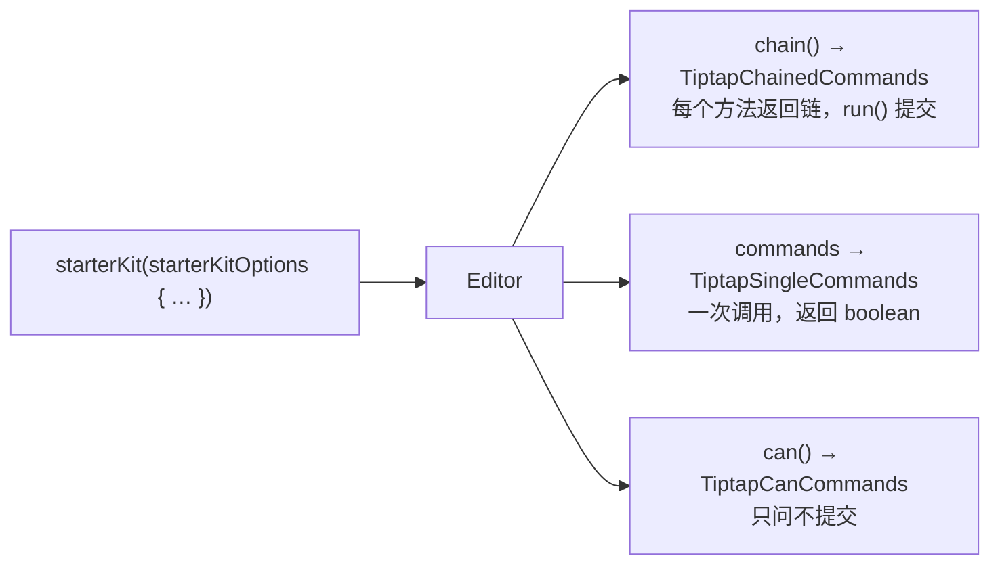

# API 概览

## 包结构

| 包 | 内容 |
| --- | --- |
| `io.github.shijianjs.ktjs.tiptap` | `Editor`、`createEditor`、`tiptapEditor`、`emptyTiptapEditor`、`TiptapExtension`、`TiptapCoreModule` |
| `…tiptap.core` | `EditorOptions`、`editorOptions`、`ParseOptions`、`parseOptions`、`LinkAttributes`、`HeadingAttributes`、`CodeBlockAttributes`、`codeBlockAttributes`、`StarterKitOptions`、`starterKitOptions`、`starterKit`、`HeadingOptions`、`headingOptions`、`StarterKitNames`、`TiptapChainedCommands`、`TiptapSingleCommands`、`TiptapCanCommands`、`TiptapEvents`、`TiptapEventPayload` |

## 本 wrapper 的约定

- **三种命令形态，三个接口。** 上游用一个巨大的联合类型从已安装扩展推导命令类型；wrapper 把
  StarterKit 那一套显式写出来：`chain()` 返回 `TiptapChainedCommands`（每个方法都返回链本身，`run()` 提交）、
  `commands` 返回 `TiptapSingleCommands`（单次调用、布尔结果）、`can()` 返回 `TiptapCanCommands`
  （每条命令返回布尔、不提交任何东西）。
- **初始化是异步的。** Tiptap 在 `setTimeout(…, 0)` 里收尾，`isInitialized` 与 `create` 事件都在那里发生。
  监听事件或在下一个宏任务里读标志；构造完立刻读内容是可行的，因为文档是同步建的。
- **选项都是 `unsafeJso` builder。** `editorOptions`、`parseOptions`、`starterKitOptions`、
  `headingOptions` 让没赋值的字段「缺席」而不是 `null`，这样 Tiptap 自己的默认值才会生效。
- **StarterKit 是工厂，不是常量。** `starterKit(options)` 内部调 `StarterKit.configure(options)` 返回配置好的
  扩展；`starterKitOptions { bold = false }` 就是「不要这一件」。
- **被配置移除的命令并不存在。** `bold = false` 之后 `editor.commands.toggleBold` 是 `undefined`；wrapper 无法
  在类型上抹掉这件事，因此要用 `can()` 或运行时判断。

## 有意放宽的类型

| 成员 | Kotlin 类型 | 原因 |
| --- | --- | --- |
| `EditorOptions.content` | `JsAny?` | 上游是 `string \| JSONContent \| JSONContent[] \| null`；字符串与数组本身就是 `JsAny` |
| `EditorOptions.extensions` | `Array<TiptapExtension>` | 扩展实例，所有 `@tiptap/extension-*` 共用一个不透明类型 |
| `EditorOptions.editorProps` | `JsAny?` | ProseMirror 的视图属性：attributes、handlers、node views |
| `EditorOptions.autofocus` | `JsAny?` | `'start' \| 'end' \| 'all' \| number \| boolean \| null` |
| `EditorOptions.enableInputRules` / `enablePasteRules` | `JsAny?` | `boolean \| string[] \| { … }` |
| `Editor.getJSON()` | `JsAny` | ProseMirror 文档树 |
| 事件负载 | `JsAny` | 每个事件的负载各不相同；需要 `editor` 时转型成 `TiptapEventPayload` |

每一行都是上游真实形状，均记在 `docs/development/technical-decisions.md`。
