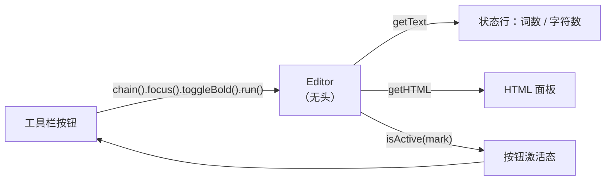

# 演示页

演示页：[https://shijianjs.github.io/ktjs-tiptap/demo/](https://shijianjs.github.io/ktjs-tiptap/demo/)

演示页在两段样例文本上挂编辑器，上面放一条工具栏。每个按钮都走 wrapper 的命令链：各类标记
（`toggleBold`、`toggleItalic`、`toggleUnderline`、`toggleStrike`、`toggleCode`）、块级命令
（`setHeading`、`setParagraph`、`toggleBulletList`、`toggleOrderedList`、`toggleBlockquote`、
`toggleCodeBlock`）、`setLink`、`undo` / `redo` 与 `clearContent`。状态行用 `getText` 数词数与字符数，
下方面板实时打印 `getHTML`，标记按钮通过 `isActive` 自己标出激活态 —— 无头编辑器没有别的办法展示状态。
语言开关会改写每个标签。

页面右上角的语言按钮在英文与简体中文之间切换，切换的是页面上全部可见文案（不只是页面标题）。

API 文档在 [https://shijianjs.github.io/ktjs-tiptap/api/](https://shijianjs.github.io/ktjs-tiptap/api/)，由 Dokka 从已发布模块生成。
