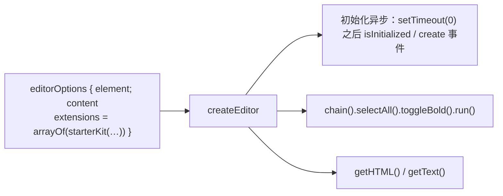

# 快速开始

## 依赖

```kotlin
kotlin {
    js {
        binaries.executable()
        browser()
    }
    sourceSets {
        jsMain.dependencies {
            implementation("io.github.shijianjs:ktjs-tiptap:3.34.0-kt.1")
            // `kotlin-browser` 的 `web.*` 类型出现在公开 API 里，所以消费方要能编译到它们。
            implementation("org.jetbrains.kotlin-wrappers:kotlin-browser:2026.11.1")
        }
    }
}
```

要求 Kotlin 2.4.21 或更新版本；wrapper 输出 ESM，`es2015` 目标起可用。

## 注册插件

Tiptap 没有插件注册表：**扩展就是传进去的对象**，而且每个 `@tiptap/extension-*` 包都是独立的 npm 依赖。本 wrapper 只带其中两个 —— 项目起步就够用的那两个：

```kotlin
import io.github.shijianjs.ktjs.tiptap.createEditor
import io.github.shijianjs.ktjs.tiptap.core.editorOptions
import io.github.shijianjs.ktjs.tiptap.core.starterKit
```

`StarterKit` 一个扩展就打包了加粗、斜体、删除线、行内代码、下划线、标题、引用、无序与有序列表、代码块、硬换行、水平线、链接、段落、文档、文本、撤销/重做、拖放光标、间隙光标、列表快捷键与尾随节点。其余扩展（`extension-table`、`extension-image`、`extension-mention` 等）不在本仓库范围内：自行添加 npm 依赖，把导入的扩展以 `JsAny` 形式放进 `extensions`。

生态里的付费部分在 Tiptap 自家 registry 的 `@tiptap-pro/*` scope 下，本仓库**没有**封装 —— 见[许可证](../license)。



## 第一个调用

```kotlin
import io.github.shijianjs.ktjs.tiptap.core.HeadingAttributes
import io.github.shijianjs.ktjs.tiptap.core.editorOptions
import io.github.shijianjs.ktjs.tiptap.core.headingOptions
import io.github.shijianjs.ktjs.tiptap.core.starterKit
import io.github.shijianjs.ktjs.tiptap.core.starterKitOptions
import io.github.shijianjs.ktjs.tiptap.createEditor

fun mount(host: web.html.HTMLElement) {
    val editor = createEditor(editorOptions {
        element = host
        content = "<p>Hello <strong>world</strong></p>"
        extensions = arrayOf(
            starterKit(starterKitOptions {
                heading = headingOptions { levels = arrayOf(1.0, 2.0, 3.0) }
            }),
        )
        onUpdate = { println(editor.getHTML()) }
    })

    // 命令链在一个事务里跑完多条命令。
    editor.chain().selectAll().toggleBold().run()
    editor.chain().selectAll().setHeading(HeadingAttributes(2.0)).run()

    println(editor.getText())
}
```

Tiptap 是无头的：编辑器元素只是一个裸 contenteditable，需要边框、间距、排版的项目要自己写 CSS。`injectCSS`（默认 `true`）只补最基本的那几条。

## 构建与测试

```bash
./gradlew build                     # 编译、Detekt、浏览器测试
./gradlew :ktjs-tiptap:jsBrowserTest     # 只跑 wrapper 的浏览器测试
./gradlew :docs:docusaurusStart     # 文档开发服务器
./gradlew pagesSite                 # 文档在 /，演示在 /demo/，Dokka 在 /api/
```
