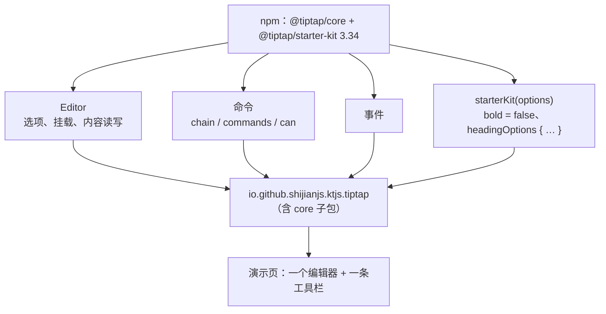

# 简介

`ktjs-tiptap` 是 [Tiptap](https://github.com/ueberdosis/tiptap) 生态里 `@tiptap/core` 3.34.0 的 Kotlin/JS wrapper：上游
`.d.ts` 里的每个类型和成员都落成可被编译器检查的 `external` 声明，不靠 `dynamic` 兜底。

封装覆盖 `@tiptap/core` 3.34 与 `@tiptap/starter-kit` 3.34（两者都是 MIT）：`Editor` 类及其选项、挂载、内容访问（`getHTML` / `getJSON` / `getText` / `setContent`）、选区助手（`isActive`、`getAttributes`）、三种命令形态（`chain`、`commands`、`can`）、插件注册方法，以及事件。命令集是 StarterKit 保证提供的那一套 —— 各类标记、节点、列表、历史命令与内容命令 —— 以及这些命令所需的属性类型。StarterKit 本身封装成一个工厂（`starterKit`），带逐扩展的开关（`bold = false`、`heading = headingOptions { levels = … }` 等）。

## 封装了哪些包

| 模块 | Gradle 坐标 | 上游 |
| --- | --- | --- |
| `ktjs-tiptap` | `io.github.shijianjs:ktjs-tiptap` | `@tiptap/core` 3.34.0、`@tiptap/starter-kit` 3.34.0 |

一个 npm scope、一个 Gradle 模块、一个 Kotlin 包（`io.github.shijianjs.ktjs.tiptap`），选项、命令、StarterKit 工厂与事件放在 `core` 子包。

三种命令形态决定了页面怎么写：`chain` 用于必须作为一步撤销的命令串，`commands` 用于单次立即执行，
`can` 用于判断某个按钮该不该可点。

## 许可证

wrapper 自身是 MIT。上游 `@tiptap/core` 的许可证与 wrapper 不同，商用前请读
[许可证说明](guide/license.md)。

## 接下来

- [快速开始](guide/getting-started.md) — 加依赖、写第一个调用、跑构建。
- [API 概览](guide/api-overview.md) — 包结构、类型映射约定、常用写法。
- [演示页](guide/demo.md) — 浏览器里直接看效果。
